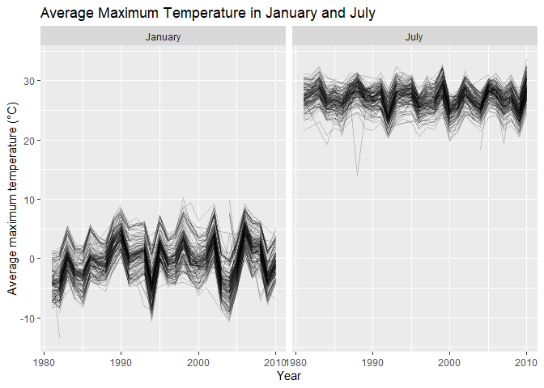
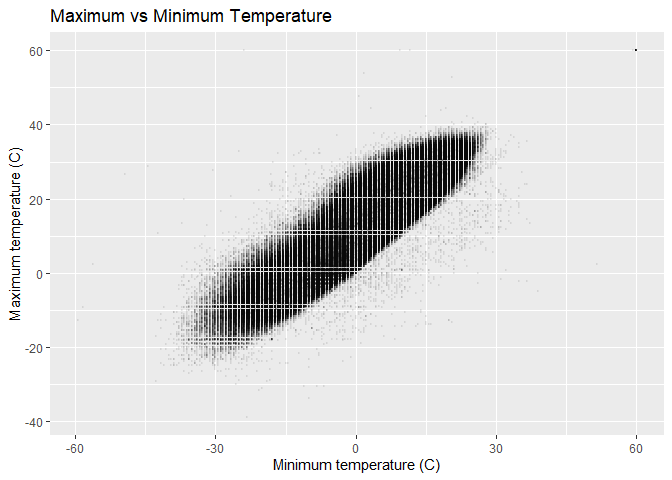
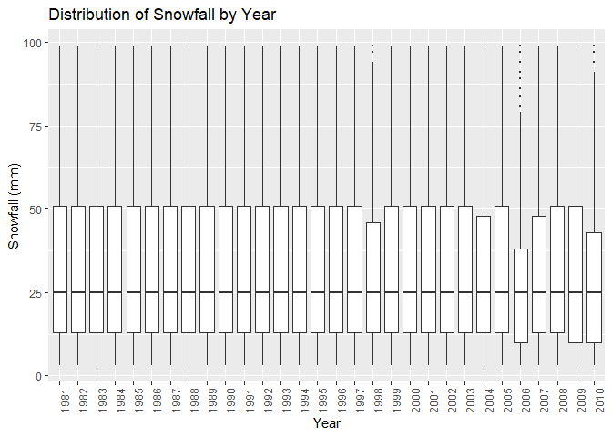
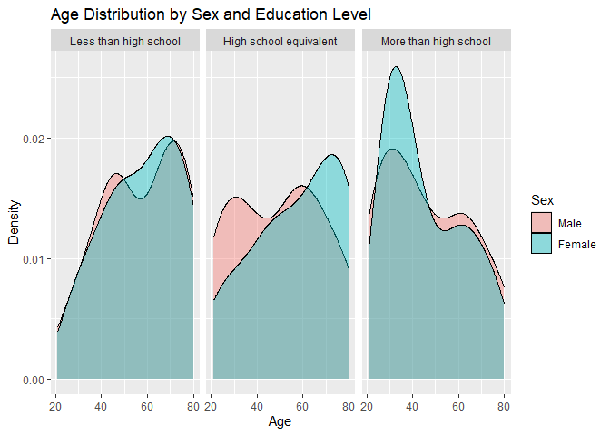
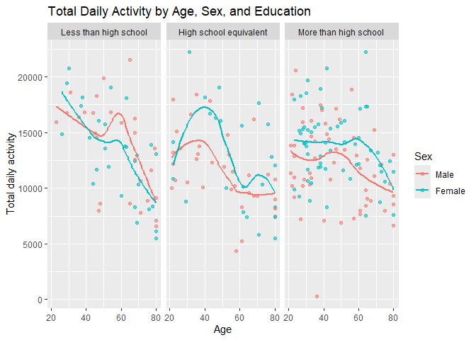
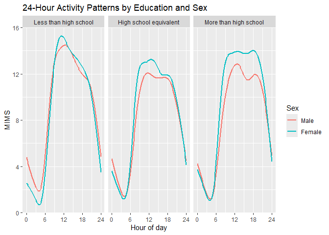

p8105_hw3_xx2554
================
2026-10-19

### Problem 1

#### Dataset Description

``` r
data("ny_noaa")

dim(ny_noaa)
```

    ## [1] 2595176       7

``` r
names(ny_noaa)
```

    ## [1] "id"   "date" "prcp" "snow" "snwd" "tmax" "tmin"

``` r
summary(ny_noaa)
```

    ##          id               date                 prcp         
    ##  Length   :2595176   Min.   :1981-01-01   Min.   :    0.00  
    ##  N.unique :    747   1st Qu.:1988-11-29   1st Qu.:    0.00  
    ##  N.blank  :      0   Median :1997-01-21   Median :    0.00  
    ##  Min.nchar:     11   Mean   :1997-01-01   Mean   :   29.82  
    ##  Max.nchar:     11   3rd Qu.:2005-09-01   3rd Qu.:   23.00  
    ##                      Max.   :2010-12-31   Max.   :22860.00  
    ##                                           NAs    :145838    
    ##       snow                snwd                tmax                tmin        
    ##  Min.   :  -13.000   Min.   :   0.00   Length   :2595176   Length   :2595176  
    ##  1st Qu.:    0.000   1st Qu.:   0.00   N.unique :    532   N.unique :    548  
    ##  Median :    0.000   Median :   0.00   N.blank  :      0   N.blank  :      0  
    ##  Mean   :    4.987   Mean   :  37.31   Min.nchar:      1   Min.nchar:      1  
    ##  3rd Qu.:    0.000   3rd Qu.:   0.00   Max.nchar:      4   Max.nchar:      4  
    ##  Max.   :10160.000   Max.   :9195.00   NAs      :1134358   NAs      :1134420  
    ##  NAs    :381221      NAs    :591786

The `ny_noaa` dataset contains 2595176 observations and 7 variables from
747 weather stations in New York State. The observations span from
1981-01-01 to 2010-12-31. Key variables include station ID (`id`), date
(`date`), precipitation (`prcp`), snowfall (`snow`), snow depth
(`snwd`), maximum temperature (`tmax`), and minimum temperature
(`tmin`).

Missing data are present in several variables, including 145838 missing
values for precipitation, 381221 for snowfall, 591786 for snow depth,
1134358 for maximum temperature, and 1134420 for minimum temperature. In
addition, `tmax` and `tmin` are currently stored as character variables
and will need to be converted during data cleaning.

#### Data Cleaning and Snowfall

``` r
ny_noaa =
  ny_noaa |>
  mutate(
    year = year(date),
    month = month(date),
    day = day(date),
    prcp = prcp / 10,
    snow = snow,
    snwd = snwd,
    tmax = as.numeric(tmax) / 10,
    tmin = as.numeric(tmin) / 10
  )
```

``` r
ny_noaa |>
  filter(!is.na(snow)) |>
  count(snow, sort = TRUE) |>
  head(10)
```

    ## # A tibble: 10 × 2
    ##     snow       n
    ##    <int>   <int>
    ##  1     0 2008508
    ##  2    25   31022
    ##  3    13   23095
    ##  4    51   18274
    ##  5    76   10173
    ##  6     8    9962
    ##  7     5    9748
    ##  8    38    9197
    ##  9     3    8790
    ## 10   102    6552

The most commonly observed snowfall value is 0 mm. Other common snowfall
values include 25, 13, 51, 76 mm. The large number of 0 mm observations
is expected because snowfall does not occur on most station-days. The
repeated nonzero values likely reflect commonly reported snowfall
amounts and rounding in the measurement process.

#### Average Maximum Temperature in January and July

``` r
temp_month_df =
  ny_noaa |>
  filter(month %in% c(1, 7)) |>
  group_by(id, year, month) |>
  summarize(
    mean_tmax = mean(tmax, na.rm = TRUE),
    .groups = "drop"
  ) |>
  filter(!is.nan(mean_tmax)) |>
  mutate(
    month = factor(
      month,
      levels = c(1, 7),
      labels = c("January", "July")
    )
  )
```

``` r
temp_month_df |>
  ggplot(aes(x = year, y = mean_tmax, group = id)) +
  geom_line(alpha = 0.2) +
  facet_grid(. ~ month) +
  labs(
    title = "Average Maximum Temperature in January and July",
    x = "Year",
    y = "Average maximum temperature (°C)"
  )
```

<!-- -->

January temperatures are much lower and more variable than July
temperatures. The mean January maximum temperature is -0.3 °C, compared
with 26.9 °C in July. Both months show clear year-to-year variation
across stations, but July temperatures are more tightly clustered. A few
unusually low station-year averages appear to be potential outliers,
especially in January.

#### Temperature and Snowfall Distributions

``` r
temp_snow_df =
  ny_noaa |>
  filter(!is.na(tmax), !is.na(tmin))

temp_snow_df |>
  ggplot(aes(x = tmin, y = tmax)) +
  geom_point(alpha = 0.05, size = 0.3) +
  labs(
    title = "Maximum vs Minimum Temperature",
    x = "Minimum temperature (C)",
    y = "Maximum temperature (C)"
  )
```

<!-- -->

``` r
ny_noaa |>
  filter(snow > 0, snow < 100) |>
  ggplot(aes(x = factor(year), y = snow)) +
  geom_boxplot(outlier.size = 0.3) +
  labs(
    title = "Distribution of Snowfall by Year",
    x = "Year",
    y = "Snowfall (mm)"
  ) +
  theme(
    axis.text.x = element_text(angle = 90, hjust = 1)
  )
```

<!-- -->

Maximum and minimum temperatures show a strong positive relationship,
with a correlation of 0.9. A few extreme temperature observations are
visible outside the main cluster. For snowfall values between 0 and 100
mm, the yearly distributions are generally similar, with an overall
median of 25 mm and only modest variation across years.

### Problem 2

#### Data Cleaning

``` r
nhanes_covar =
  read_csv(
    "data/nhanes_covar.csv",
    skip = 4
  )

nhanes_accel =
  read_csv("data/nhanes_accel.csv")

head(nhanes_covar)
```

    ## # A tibble: 6 × 5
    ##    SEQN   sex   age   BMI education
    ##   <dbl> <dbl> <dbl> <dbl>     <dbl>
    ## 1 62161     1    22  23.3         2
    ## 2 62164     2    44  23.2         3
    ## 3 62169     1    21  20.1         2
    ## 4 62174     1    80  33.9         3
    ## 5 62177     1    51  20.1         2
    ## 6 62178     1    80  28.5         2

``` r
names(nhanes_accel)[1:6]
```

    ## [1] "SEQN" "min1" "min2" "min3" "min4" "min5"

``` r
tail(names(nhanes_accel))
```

    ## [1] "min1435" "min1436" "min1437" "min1438" "min1439" "min1440"

``` r
nhanes_covar_clean =
  nhanes_covar |>
  filter(age >= 21) |>
  drop_na(sex, age, BMI, education) |>
  mutate(
    sex = factor(
      sex,
      levels = c(1, 2),
      labels = c("Male", "Female")
    ),
    education = factor(
      education,
      levels = c(1, 2, 3),
      labels = c(
        "Less than high school",
        "High school equivalent",
        "More than high school"
      )
    )
  )

nhanes_accel_long =
  nhanes_accel |>
  pivot_longer(
    min1:min1440,
    names_to = "minute",
    values_to = "MIMS"
  ) |>
  mutate(
    minute = parse_number(minute)
  )

nhanes_df =
  nhanes_covar_clean |>
  inner_join(nhanes_accel_long, by = "SEQN")
```

``` r
glimpse(nhanes_df)
```

    ## Rows: 328,320
    ## Columns: 7
    ## $ SEQN      <dbl> 62161, 62161, 62161, 62161, 62161, 62161, 62161, 62161, 6216…
    ## $ sex       <fct> Male, Male, Male, Male, Male, Male, Male, Male, Male, Male, …
    ## $ age       <dbl> 22, 22, 22, 22, 22, 22, 22, 22, 22, 22, 22, 22, 22, 22, 22, …
    ## $ BMI       <dbl> 23.3, 23.3, 23.3, 23.3, 23.3, 23.3, 23.3, 23.3, 23.3, 23.3, …
    ## $ education <fct> High school equivalent, High school equivalent, High school …
    ## $ minute    <dbl> 1, 2, 3, 4, 5, 6, 7, 8, 9, 10, 11, 12, 13, 14, 15, 16, 17, 1…
    ## $ MIMS      <dbl> 1.10600000, 3.11516667, 1.46750000, 0.93766667, 1.59866667, …

``` r
n_distinct(nhanes_df$SEQN)
```

    ## [1] 228

After cleaning and merging the demographic and accelerometer data, the
final dataset contains 228 participants and 328320 minute-level
observations. Participants younger than 21 years and those with missing
demographic data were excluded, and sex and education were encoded as
factors.

#### Demographic Table and Age Distribution

``` r
demographic_table =
  nhanes_covar_clean |>
  count(education, sex) |>
  pivot_wider(
    names_from = sex,
    values_from = n
  )

knitr::kable(
  demographic_table,
  caption = "Number of Participants by Education Level and Sex"
)
```

| education              | Male | Female |
|:-----------------------|-----:|-------:|
| Less than high school  |   27 |     28 |
| High school equivalent |   35 |     23 |
| More than high school  |   56 |     59 |

Number of Participants by Education Level and Sex

``` r
nhanes_covar_clean |>
  ggplot(aes(x = age, fill = sex)) +
  geom_density(alpha = 0.4) +
  facet_wrap(~ education, nrow = 1) +
  labs(
    title = "Age Distribution by Sex and Education Level",
    x = "Age",
    y = "Density",
    fill = "Sex"
  )
```

<!-- --> The
largest education group is “More than high school,” with 115
participants and similar numbers of men and women. The “High school
equivalent” group has more men than women, while the “Less than high
school” group is nearly balanced by sex. The age distributions overlap
substantially within each education category, although some differences
in shape are visible between men and women, particularly in the higher
education groups.

#### Total Daily Activity

``` r
total_activity_df =
  nhanes_df |>
  group_by(SEQN, sex, age, BMI, education) |>
  summarize(
    total_activity = sum(MIMS, na.rm = TRUE),
    .groups = "drop"
  )
```

``` r
total_activity_df |>
  ggplot(aes(x = age, y = total_activity, color = sex)) +
  geom_point(alpha = 0.6) +
  geom_smooth(se = FALSE) +
  facet_wrap(~ education, nrow = 1) +
  labs(
    title = "Total Daily Activity by Age, Sex, and Education",
    x = "Age",
    y = "Total daily activity",
    color = "Sex"
  )
```

<!-- -->

Total daily activity generally decreases with age across all three
education groups. The smoothed trends suggest some differences between
men and women, although these patterns vary by education level. Overall,
activity levels tend to be lower at older ages.

#### 24-Hour Activity Patterns

``` r
activity_time_df =
  nhanes_df |>
  mutate(
    hour = minute / 60
  )
```

``` r
activity_time_df |>
  ggplot(aes(x = hour, y = MIMS, color = sex)) +
  geom_smooth(se = FALSE) +
  facet_wrap(~ education, nrow = 1) +
  labs(
    title = "24-Hour Activity Patterns by Education and Sex",
    x = "Hour of day",
    y = "MIMS",
    color = "Sex"
  ) +
  scale_x_continuous(
    breaks = c(0, 6, 12, 18, 24)
  )
```

<!-- -->
Across all three education groups, activity is lowest overnight, rises
sharply in the morning, remains relatively high during the daytime, and
declines again in the evening. Women generally show slightly higher
daytime activity than men, with the difference appearing most clearly in
the “More than high school” group. Overall, the 24-hour activity
patterns are broadly similar across education levels.

### Problem 3
